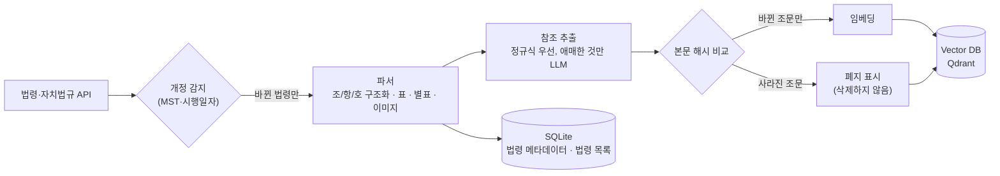
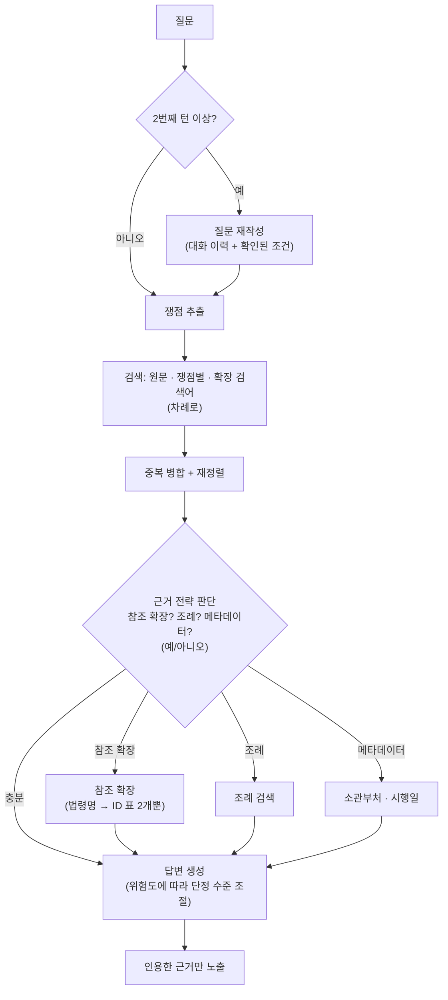
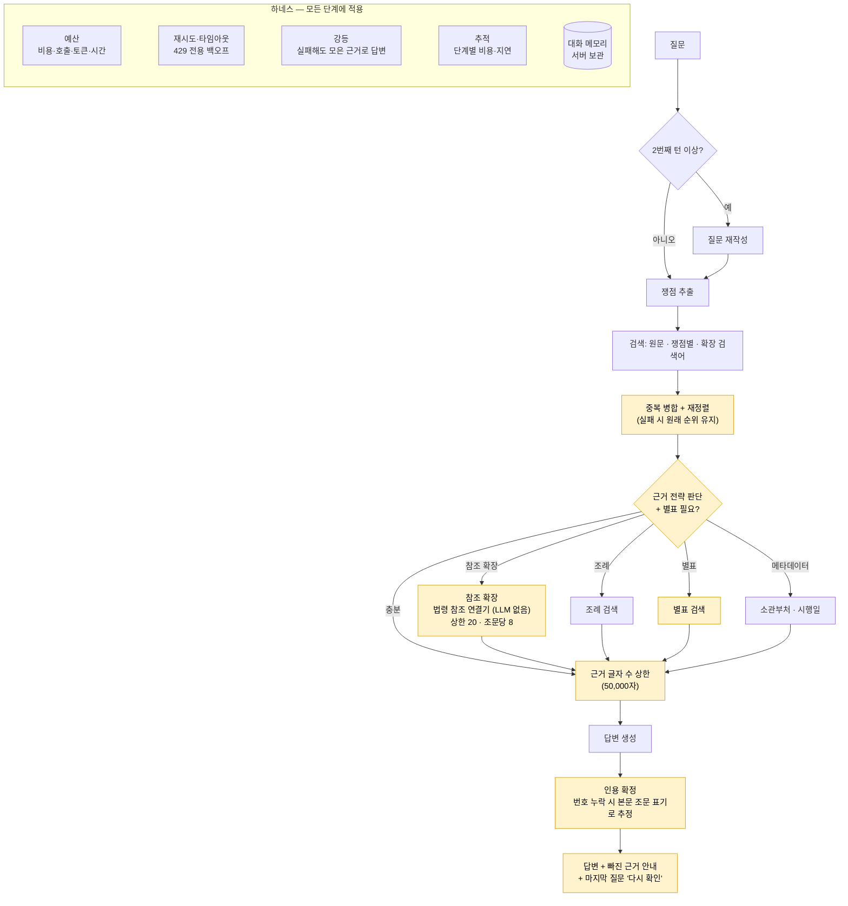
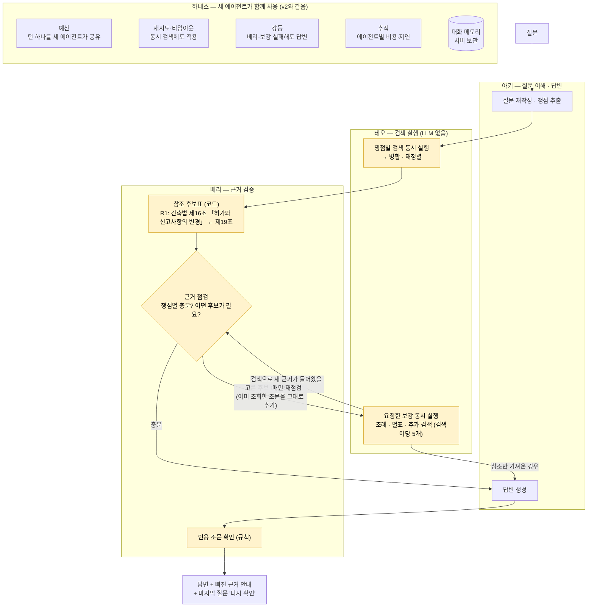
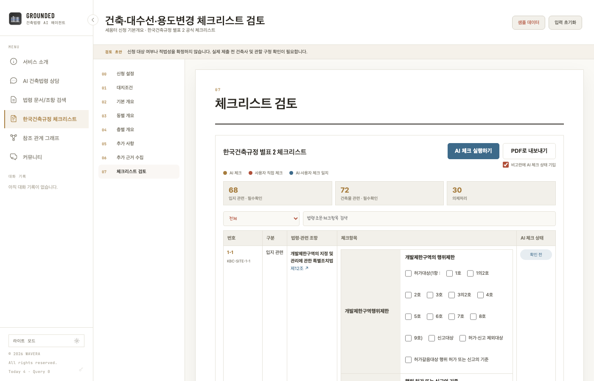
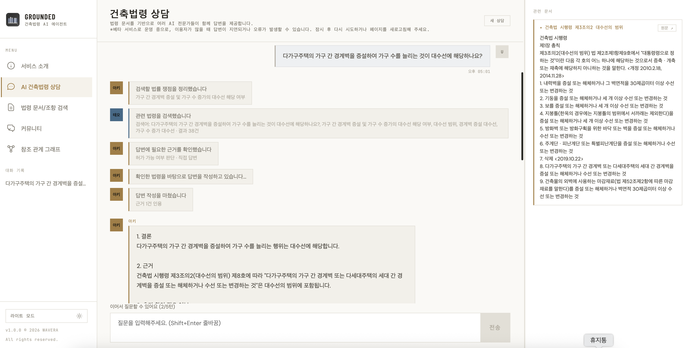
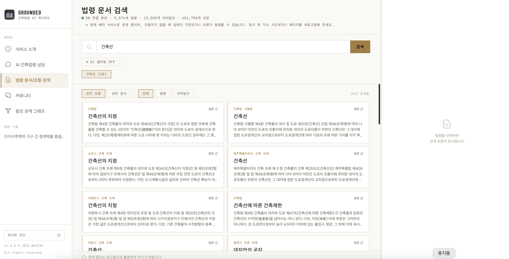
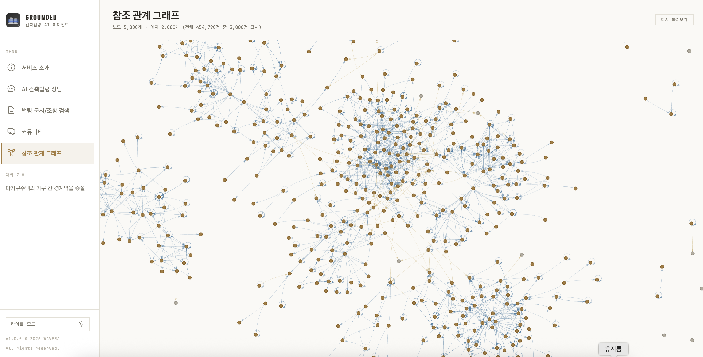

# GROUNDED (그라운디드): 건축 법령 AI 에이전트 하네스 (포트폴리오용)

> 법령 검색을 넘어, **대화형 상담 + 조문 근거 + 참조 관계 추적**까지 제공하는 AI 에이전트 서비스

👉🏻 [GROUNDED (건축 법령 AI 에이전트 하네스)](https://grounded.thewavera.com/)

## 목차

- [Overview](#overview)
- [Key Features](#key-features)
- [Architecture](#architecture)
  - [공통 — 데이터 수집 파이프라인](#공통--데이터-수집-파이프라인)
  - [v1 — 고정 파이프라인 (초기 운영)](#v1--고정-파이프라인-초기-운영)
  - [v2 — 에이전트 하네스 (현재 운영)](#v2--에이전트-하네스-현재-운영)
  - [v3 — 멀티 에이전트 하네스: 아키 · 테오 · 베리 (실험)](#v3--멀티-에이전트-하네스-아키--테오--베리-실험)
  - [세 버전 한눈에](#세-버전-한눈에)
- [Challenges & Solutions](#challenges--solutions)
- [Data Engineering](#data-engineering)
- [Evaluation](#evaluation)
- [Experiments](#experiments)
  - [실험 1 — 하이브리드 검색(BM25 + 형태소 분석): 기각](#실험-1--하이브리드-검색bm25--형태소-분석-기각)
  - [실험 2 — 같은 법령 내 재검색: 기각](#실험-2--같은-법령-내-재검색-기각)
  - [실험 3 — 인용 빈도 신호: 기각](#실험-3--인용-빈도-신호-기각)
  - [실험 4 — 참조확장 강제 실행 애블레이션: 진짜 병목 발견](#실험-4--참조확장-강제-실행-애블레이션-진짜-병목-발견)
- [Agent Evolution — v1 → v2 → v3](#agent-evolution--v1--v2--v3)
  - [v2 — "실패를 숨기지 않는" 에이전트 하네스](#v2--실패를-숨기지-않는-에이전트-하네스)
  - [v3 — 근거 판단을 맡는 검증 에이전트](#v3--근거-판단을-맡는-검증-에이전트)
  - [성능 평가 — 핵심 결과](#성능-평가--핵심-결과)
  - [배운 것](#배운-것)
- [Checklist — 공식 서식 자동 채우기](#checklist--공식-서식-자동-채우기)
- [Prompts](#prompts)
- [Tech Stack](#tech-stack)
- [Screenshots](#screenshots)

## Overview

GROUNDED는 건축 인허가 관련 질의를 자연어로 입력하면, 관련 법령/자치법규 조문을 검색하고 근거를 확장한 뒤 실제 조문을 인용해 답변하는 법령 특화 AI 상담 서비스입니다. 1인 개발로 시작해 실사용 서비스로 배포·운영 중이며, 법령(5,000여 건)과 지자체 자치법규(13,500여 건)를 함께 다룹니다.

### 왜 이 프로젝트를 시작했는가 — 법제처 자체 AI도 아직 못 푸는 문제

법제처(law.go.kr)는 이미 "자주 찾는 질문" 페이지에 질문과 관련 조항을 AI로 매칭해주는 기능을 운영 중입니다. 이게 실제로 얼마나 쓸 만한지 직접 검증하려고 공개된 FAQ 830건 전체를 수집하고 그중 건축법령 관련 질의를 선별해 관련조항 API 응답을 직접 확인했습니다. 표본이 7건으로 작아 법제처 서비스 전체에 대한 결론은 아니지만, 채워야 할 공백이 실제로 존재한다는 근거로는 충분했습니다:

- **건축 분야 커버리지가 거의 없음** — 전체 18개 카테고리 중 건축 전용 카테고리가 없고, "건물/건축"이 언급된 질의도 대부분 상가임대차·소방 등 다른 분야였습니다.
- **관련조항만 있고 답변이 없음** — 조문 5개를 나열할 뿐, 그걸 종합한 결론은 사용자가 직접 읽고 판단해야 합니다.
- **관련조항 5개로 고정, 더보기 없음** — 전체가 몇 개인지, 5개로 충분한지 확인할 방법이 없습니다.
- **정작 결정적인 조문이 빠짐** — 예: "가구 간 경계벽 증설이 대수선인지" 질의에 대수선의 정의(건축법 제2조)만 있고, 그 정의가 위임한 구체적 범위(시행령 제3조의2)는 빠져 있어 정작 질문의 핵심을 판단할 근거가 없었습니다.
- **대화 맥락이 없고, 자치법규(지자체 조례)는 다루지 않음** — 질의가 매번 독립적으로 처리되고, 실무에서 자주 걸리는 지자체 조례는 결과에 나오지 않았습니다.

GROUNDED는 이 공백들 — 근거 나열이 아니라 실제 답변까지, 고정 개수가 아니라 필요한 만큼, 결정적 조문 누락 없이, 대화형으로, 자치법규까지 — 을 메우는 것을 목표로 설계했습니다. 근본 원인은 법령 데이터 자체의 복잡성입니다: 조문은 조/항/호 구조, 다른 조문·다른 법령에 대한 상호참조, 지자체별로 달라지는 조례가 얽혀 있어 단순 벡터 검색만으로는 실무 품질의 답변을 만들기 어렵습니다. 이를 풀기 위해 (1) 질의에서 법률 쟁점을 뽑아 여러 방식으로 검색하고, (2) 근거가 충분한지 판단해 필요한 것만 추가로 모으고, (3) 여러 턴에 걸친 대화에서는 이전 문맥으로 다음 질문을 재작성하는 파이프라인을 설계했습니다.

## Key Features

1. 법률 쟁점 기반 검색
- 질문에서 검색해야 할 법률 쟁점을 추출(예: "건폐율, 건축선"처럼 복수 쟁점을 각각 분리)
- 원문 검색 + 쟁점별 검색 + 쟁점별 확장 검색어를 함께 사용, 중복 등장 빈도로 후보를 재정렬

2. 근거 수집 전략 판단
- 1차 검색 결과만으로 답변이 충분한지, 참조 조문 확장이 필요한지, 지역 조례를 더 찾아야 하는지, 담당부서 정보가 필요한지를 답변 생성 전에 먼저 판단
- 질문의 위험도(단정하면 안 되는 허가/위반 판단 등)에 따라 답변 톤을 다르게 유도

3. 참조 조문 추적 + 관계 시각화
- 조문 안의 내부/외부 참조를 추적해 검색에 안 잡힌 근거 조문을 추가로 확보
- 법령 간 참조 관계를 그래프로 시각화하는 별도 페이지 제공

4. 대화형 멀티턴 상담
- 첫 질문 이후 이어지는 질문("그럼 주차장은?")을 이전 대화 맥락으로 독립적인 질문으로 재작성해서 검색
- 대화 중 확인된 조건(지역/용도/공사유형 등)을 다음 턴에도 유지하고, 정정되면 갱신

5. 자치법규 통합 검색
- 국가 법령뿐 아니라 지자체 조례/규칙까지 같은 파이프라인으로 검색
- 법령 표(table)를 원문 구조를 살려 화면에 표시

6. 한국건축규정 체크리스트 (국토교통부 공식 서식 기반)
- 대지조건/기본개요/동별·층별 개요를 입력하면 국토교통부 한국건축규정 별표 2 체크리스트(170개 항목)를 자동으로 채울 범위를 판정
- 입력된 정보를 근거로 각 항목을 AI가 검토해 확인/직접 판단/추가 확인 필요로 분류, 근거 조문을 함께 제시
- 원본 공식 서식 그대로 PDF로 내보내기 지원(AI 검토 상태를 비고란에 함께 기입할지 선택 가능)

## Architecture

상담 에이전트는 세 번 설계했습니다(v1 → v2 → v3, 과정과 수치는 [Agent Evolution](#agent-evolution--v1--v2--v3)). 세 버전은 **같은 데이터·검색 기반**을 쓰고, **근거를 모으고 답하는 방식**이 다릅니다. 아래 그림은 같은 단계 이름을 쓰고, **이전 버전에서 바뀐 단계만 색으로** 표시했습니다.

### 공통 — 데이터 수집 파이프라인



### v1 — 고정 파이프라인 (초기 운영)



- 판단 LLM이 플래그를 한 번 채우면 코드가 정해진 순서로 실행합니다. 실패는 기본값으로 처리되고(예: 429 → "참조 불필요"), 대화 상태는 클라이언트가 통째로 들고 왕복합니다.

### v2 — 에이전트 하네스 (현재 운영)



- 흐름은 v1과 같고, 색칠한 단계가 바뀐 곳입니다. 모든 단계는 하네스(예산·재시도·강등·추적)를 거치며, 실패한 근거는 숨기지 않고 사용자에게 알립니다.

### v3 — 멀티 에이전트 하네스: 아키 · 테오 · 베리 (실험)



- v2의 "근거 전략 판단(예/아니오)"을 베리가 대신합니다. 베리는 참조 대상 조문의 **제목까지 붙은 후보표**를 보고 필요한 것만 번호로 고릅니다.
- 하네스는 v2 것을 그대로 씁니다 — 턴 하나의 예산을 세 에이전트가 함께 쓰고, 테오의 동시 검색도 같은 재시도·타임아웃을 거치며, 베리나 보강 작업이 실패해도 모은 근거로 답하고 빠진 근거를 알립니다.

### 세 버전 한눈에

| 단계 | v1 | v2 | v3 |
|---|---|---|---|
| 검색 | 쟁점별로 차례로 | 같음(실패 시 원래 순위) | **동시 실행**(1차 검색 −45%) |
| 근거 보강 판단 | LLM이 예/아니오 플래그 | 같음 + 별표 판단 | **베리가 후보표에서 번호로 선택** |
| 다른 법령 참조 연결 | 표 2개(3.9%) | **연결기(97.9%)** | 같음 |
| 근거 양 통제 | 없음(최대 109개 추가) | **확장 상한 + 글자 수 상한** | + 요청 검색 상한 |
| 실패 처리 | 기본값으로 숨김 | **기록 · 강등 · 빠진 근거 안내 · 다시 확인** | 같음 |
| 대화 상태 | 클라이언트가 왕복 | **서버 보관** | 같음 |
| LLM 호출 / 턴 | 약 4회 | 약 4회 | 4~5회 |

### 오케스트레이션 이력 — 절차적 코드에서 LangGraph로

위 흐름은 처음엔 하나의 함수 안에서 `if`로 분기하는 절차적 코드로 구현했습니다. 대화 재개 시 이전 턴의 상태 중 일부만 이어받는 버그가 반복되자(어떤 필드를 이어받을지가 여러 곳에 흩어져 있어 하나씩 빠뜨리기 쉬움), 검색·근거수집 로직은 그대로 두고 **제어 흐름만 LangGraph의 `StateGraph`로 옮겼습니다** — 위 다이어그램의 각 단계가 노드로, `PLAN`/`C0` 같은 분기점이 조건부 엣지로 대응됩니다. 기존 로직은 한 줄도 재작성하지 않고 그대로 노드에서 호출만 하도록 감싸서, 프롬프트나 답변 품질에는 영향 없이 오케스트레이션 레이어만 교체했습니다. SSE 스트리밍도 LangGraph의 커스텀 스트림(`stream_mode`)으로 그대로 유지됩니다.

v2는 이 그래프 위에 하네스를 얹은 새 구현이고(기존 운영 코드는 그대로 두고 옆에 만든 뒤 평가로 검증해 교체), v3는 v2의 실행기·하네스를 그대로 쓰고 그래프만 바꿨습니다.

## Challenges & Solutions

### 핵심 문제 — 단순 벡터 검색으로는 왜 안 되는가

Overview에서 짚은 법제처 자체 AI의 공백(결정적 조문 누락, 대화 맥락 없음) 중 실제로 GROUNDED를 만들면서 부딪힌 두 가지를 구체적으로 재현·해결한 사례입니다.

1. 법령 상호참조로 인한 결정적 조문 누락
- 문제: 조문에 적힌 참조 표현(`"제19조의15"` 같은 본조+가지번호 결합 형태)이 실제 검색 인덱스의 필드 구조(본조/가지번호 분리 저장)와 형태가 달라서, 참조가 실제로 존재하는 조문을 가리켜도 매칭에 계속 실패 — 법제처 FAQ 사례에서 확인한 "정의 조문만 있고 그 정의가 위임한 시행령 조문은 빠지는" 문제와 근본 원인이 같음
- 해결: 참조 표현을 인덱스 필드 형태로 분리하는 정규화 단계 추가, 참조 매칭 전용 조회 경로 별도 구성
- 결과: 검색 결과에 없던 근거 조문(결격사유 등)이 실제로 답변에 반영됨을 확인

2. 후속 질문이 이전 문맥 없이 검색되는 문제
- 문제: "그럼 주차장은?" 같은 후속 질문을 그대로 검색하면 이전 대화("다가구주택 증축")의 맥락이 사라져 무관한 결과가 섞임 — 법제처 FAQ가 질의를 매번 독립적으로 처리하는 것과 같은 한계
- 해결: 이전 대화 이력 + 이미 확인된 사용자 조건을 참고해 현재 질문을 독립적인 질문으로 재작성하는 단계를 검색 전에 추가
- 결과: 재작성된 질문으로 검색하니 실제로 관련 조례(부설주차장 설치기준)가 근거로 잡히는 것을 확인

### 구현 중 만난 기술적 도전

위 핵심 문제를 실제 서비스로 배포·운영하는 과정에서 만난 문제들입니다.

3. 오케스트레이션 프레임워크 마이그레이션 중 프레임워크 자체의 숨겨진 동작 발견
- 문제: 절차적 분기 코드를 LangGraph `StateGraph`로 옮긴 뒤, 범위 외 질문이 정상 검색 경로로 새는 라우팅 버그 발생 — 조건부 엣지 함수의 파라미터에 상태 타입힌트를 붙이면 LangGraph가 "이 분기는 타입에 선언된 필드만 필요하다"고 자동 추론해서, 동적으로 추가한 상태 키를 라우팅 시점에 조용히 누락시키는 게 원인이었음(공식 문서에 명시되지 않은 동작)
- 해결: 소스 레벨에서 원인을 직접 추적(내부 스코프 추론 로직 확인) 후, 조건부 엣지가 참조하는 모든 상태 키를 타입 스키마에 명시적으로 선언
- 결과: 신구 오케스트레이션을 동일 입력으로 나란히 실행해 라우팅·응답·실시간 스트리밍이 모두 동등함을 확인 후 프로덕션에 적용

4. 스캔본이 아닌 원본 PDF 서식에 실제로 체크 표시를 찍는 문제
- 문제: 국토교통부 공식 체크리스트 PDF(170개 항목·1,188개 체크박스)는 AcroForm 필드가 없는 텍스트 기반 문서라, 값만 채우는 방식은 불가능 — 좌표를 찾아 직접 그려 넣어야 함. 항목 번호 라벨의 y좌표를 앵커로 삼는 1차 방식은 라벨이 셀 안에서 세로 중앙 정렬돼 있어 127개(75%) 항목에서 체크박스 개수가 실제와 불일치
- 해결: 텍스트 위치 대신 PDF에 벡터로 그려진 표 경계선(가로선) 좌표를 기준으로 각 항목의 행 범위를 재구성하는 방식으로 전환 — 번호가 다음 행 경계까지 걸치는 경우(하위 그룹 병합)도 처리
- 결과: 170개 항목 전체 좌표 매핑 검증 100% 달성, 매핑이 검증 안 된 항목은 추정으로 잘못된 칸에 체크하는 대신 표시를 생략하도록 설계

5. 파서를 고쳤는데 인덱스에는 반영 안 되는 조용한 회귀
- 문제: 법령 원문의 병합 셀(ROWSPAN/COLSPAN) 표를 텍스트로 변환하는 파서 로직을 수정했지만, "이미 색인된 문서를 재파싱할지" 판단하는 버전 게이트 상수를 그 수정과 함께 올리지 않음 — 이후 재색인 배치를 반복 실행해도 버전이 같다고 판단해 스킵되면서, 이미 벡터 DB에 들어간 표 데이터는 몇 주간 파싱 오류가 있는 옛 버전 그대로 방치됨. 에러 없이 조용히 실패하는 유형이라 검색 품질 저하로만 나타나 발견이 늦음
- 해결: 파서 로직이 실제로 바뀐 날짜와 버전 상수가 마지막으로 갱신된 날짜를 대조해서 불일치를 확인한 뒤 버전 상수를 재갱신 — 이후 "파서 로직 변경 시 버전 상수를 함께 올린다"를 재색인 파이프라인 체크리스트에 명시해 재발을 구조적으로 방지
- 결과: 다음 재색인 배치부터 병합 셀이 있는 표 전체가 올바른 텍스트로 재반영됨. RAG 파이프라인에서는 코드 수정 자체보다 "그 수정이 실제로 인덱스에 도달했는지"를 별도로 검증해야 한다는 교훈

6. 로컬에서는 통과하고 배포 환경에서만 재현되는 경로 버그
- 문제: 배포 직후 특정 기능이 500 에러로 죽음(`FileNotFoundError: .../site-packages/.../data/...json`) — 원인은 로컬 데이터 파일 경로를 소스 파일 위치 기준 상대경로(`Path(__file__).resolve().parents[N]`)로 계산하던 코드였는데, Docker 이미지 빌드 시 `pip install .`(non-editable)이 소스를 `site-packages/`로 복사하면서 파일 위치 자체가 달라져 경로 계산이 깨짐. 로컬 개발 환경(editable install)에서는 소스 위치가 그대로라 문제가 전혀 드러나지 않음
- 해결: 실제 배포 로그의 스택트레이스에 찍힌 절대경로로 어긋난 디렉터리 깊이를 역산해 원인을 특정한 뒤, 경로 계산 기준을 소스 파일 위치가 아니라 프로세스의 현재 작업 디렉터리(Docker `WORKDIR`, 이미 다른 모듈이 쓰던 패턴) 기준으로 통일
- 결과: 로컬·배포 환경에서 동일 코드로 동일하게 동작함을 확인. "패키징 방식(editable vs non-editable)에 따라 결과가 달라지는 경로 가정"을 만들지 않는 것을 이후 신규 코드의 기본 원칙으로 채택

## Data Engineering

이 프로젝트에서 가장 많은 시간이 들어간 영역입니다. 법령 데이터는 "API로 받아서 임베딩하면 끝"이 아니라, **원문의 구조를 얼마나 살려서 청크로 만드느냐가 검색 품질을 그대로 결정**합니다. 아래는 실제로 데이터가 깨졌던 지점과 그 대응입니다.

### 수집 규모

| 구분 | 규모 |
|---|---|
| 중앙 법령 | 약 5,600건 (법률·시행령·시행규칙·부령) |
| 자치법규 | 약 14,300건 (지자체 조례·규칙, 건축 관련 키워드로 큐레이션) |
| 로컬 파싱 캐시 | 약 1GB (`data/chunks`, `data/chunks_ordin`) |
| 실서비스 벡터 인덱스 | 87,403 포인트 |

### 청킹 단위 — "항 단위"에서 "조 단위"로 되돌린 이유

처음엔 항(paragraph) 단위로 잘게 쪼갰습니다. 그런데 청크의 고유 키를 `법령ID:조번호:가지번호`까지만 구성해둔 탓에, **같은 조에 속한 항들이 색인 단계에서 서로를 덮어써서 조당 항 하나만 살아남는 데이터 손실**이 있었습니다(건축법 기준 529개 → 166개). 파싱 단계에서 아예 조 단위로 항을 모두 합쳐 하나의 청크로 만드는 방식으로 되돌려 해결했습니다.

이 과정에서 배운 건, 청킹 단위를 바꿀 때 **고유 키 설계도 함께 바뀌어야 하는데 그게 분리돼 있으면 조용히 소실된다**는 점입니다. 에러가 안 나고 개수만 줄어서 발견이 늦었습니다.

### 구조 보존 — 호·목, 표, 별표, 이미지

- **호/목 누락**: 정의 조항처럼 핵심 내용이 `항` 본문이 아니라 별도의 `호`/`목` 구조에 들어 있는 경우를 파서가 읽지 않아, 건축법 제2조(정의)가 **242자**로만 저장돼 있었습니다(정의 21개 항목이 통째로 누락). 재귀적으로 호·목까지 읽도록 수정해 **3,352자**로 복원했습니다.
- **표**: 표를 `[[TABLE]]...[[/TABLE]]` 마커로 변환해 원문 구조를 유지합니다. API가 표·장제목을 중첩 리스트로 내려줄 때 파이썬 리스트 repr 문자열(`"[['구분', '기준'], ...]"`)이 그대로 저장되던 버그가 있어 평탄화 로직을 추가했고, 5,596건 전체 재파싱으로 잔재 0건을 확인했습니다.
- **병합 셀**: ROWSPAN/COLSPAN이 있는 표에서 셀을 순서대로만 나열해 행마다 셀 개수가 어긋나는 문제 — 파서는 고쳤지만 **이미 색인된 데이터에는 소급 적용되지 않았습니다**(Challenges 5번 참고).
- **별표(부록 표)**: 1만자 이하는 통째로, 초과하면 최상위 번호 단위로 분할하되 "비고"는 모든 조각에 공통 부착. 기본 검색에서는 제외하고 **"별표 N 참조" 패턴이 감지될 때만** 노출합니다 — 별표는 길고 수치 위주라 일반 검색에 섞이면 노이즈가 됩니다.
- **이미지**: 원문의 도면·서식 이미지는 파싱 시점에 내려받아 오브젝트 스토리지에 올리고 `[[IMAGE:N]]` 마커로 대체합니다.

### 삭제·폐지 조문 필터링

`"제81조 삭제"`처럼 내용 없이 자리만 남은 조문이 검색 결과에 그대로 노출되던 문제가 있었습니다. `is_repealed` 필드를 추가하고 기존 16,284개 조문을 백필해 기본 검색에서 제외하되, **참조로 명시 지목되면 여전히 조회 가능**하도록 남겼습니다(구법 기준 해석을 다룰 때 필요).

### 조문 간 참조 추출

조문 본문에서 다른 조문·다른 법령에 대한 참조를 LLM으로 추출해 payload에 별도 patch합니다(**벡터 재계산 없이 payload만 갱신** — 재임베딩 비용 회피).

운영하며 겪은 것들:
- **부분 실패 시 전체 재추출**: 라운드 끝에서만 결과를 저장하던 구조라 청크 하나만 실패해도 법령 전체를 다시 추출했습니다(API 비용 직결). 청크 성공마다 즉시 체크포인트를 쓰도록 재작성해 미완료분만 재시도하게 했습니다.
- **자기참조**: `internal_refs`가 자기 자신을 가리키는 항목이 섞여 있어, 추출 시점과 DB 반영 시점 양쪽에 필터를 넣고 기존 데이터 54,675개를 스캔해 1,296개를 제거했습니다.
- **현재 커버리지는 14.6%** (12,751 / 87,403 청크). LLM 제공자의 사용량 한도로 중단·재개를 반복 중이며, 체크포인트 덕분에 유실 없이 이어집니다. 이 커버리지가 낮다는 사실이 뒤의 실험 결과(참조확장 효과의 천장)를 해석하는 전제가 됩니다.

### 증분 색인 — 바뀐 것만 다시 임베딩

청크별 `content_hash`와 `embedded_hash`를 비교해 **내용이 실제로 바뀐 청크만** 재임베딩합니다. 전체 프로덕션 스캔(5,596개 법령, 34분) 결과 204,206개 청크 중 **78,656개(38.5%)만** 재임베딩 대상으로 잡혀, "부분" 재임베딩이 유의미하게 작동함을 확인했습니다.

여기서 중요한 함정이 있었습니다 — 파서 버전 상수를 올리지 않으면 "이미 최신"으로 판단해 **고친 파서가 영원히 반영되지 않습니다**(Challenges 5번).

### 임베딩 모델 교체 — 로컬 모델에서 API로

초기에는 로컬 `sentence-transformers` 한국어 모델을 썼는데, 프로덕션 서버가 임베딩 모델을 직접 띄워야 해서 콜드스타트와 메모리 부담이 컸습니다. 모델의 기본 `max_seq_length`가 8192인데 실제 조문 길이는 중앙값 176 토큰(p99 1,022)이라 과도해서, 1024로 캡을 씌워 peak 메모리를 982MB → 712MB(**-27%**)로 줄이고 연산량을 약 6배 줄이기도 했습니다.

최종적으로는 Voyage AI API로 전환하면서 **벡터 공간이 달라 재사용이 불가능**해 전체 재적재(216,517개 청크, 실패 0건)를 했습니다. 서버에서 임베딩 모델을 제거할 수 있게 된 대신, 외부 API 의존이 생겨 재시도 설계가 필요해졌습니다(타임아웃 재시도 누락으로 검색이 500을 뱉던 버그를 배포 후에 발견).

### 벡터 DB 용량 한계 — 전체 적재에서 "건축 코어"로 범위 재설계

자치법규까지 전부 넣자 포인트가 216K → 454K로 늘어 클라우드 플랜 디스크 한도(456,484 포인트)를 넘겨 **optimizer가 실패하고 검색이 죽는** 상태가 됐습니다. 포인트를 지워도 공간이 바로 회수되지 않아, 컬렉션을 드롭하고 범위를 다시 설계했습니다:

```
건축 코어        법령 199건 + 자치법규 1,630건 + 별표      = 54,675 포인트
참조 그래프 확장  코어가 참조하는 법령 337건 (1-hop)        = 35,461 포인트
                                                   합계  ≈ 87,000 포인트
```

나머지(세법·병역·선거 등 건축과 무관한 도메인)는 **재임베딩 없이 재투입 가능한 형태로 로컬 백업**에 보관합니다. "전부 넣는다"에서 "참조 그래프로 필요한 만큼 넓힌다"로 바꾼 것인데, 이 선택의 대가는 뒤의 평가에서 드러납니다 — **코어 밖 법령이 정답인 질의는 검색 품질과 무관하게 맞출 수 없습니다.**

### 검색 인덱스와 메타데이터 분리

법령 단위로 한 번만 존재하는 값(소관부처, 담당부서 연락처, 시행일)을 벡터 DB payload에 중복 저장하지 않고 SQLite로 분리했습니다. 검색 결과의 `law_key`를 모아 **배치 한 번으로 조회해 merge**하는 방식이라 N+1 쿼리가 없고, 구버전 색인 데이터에 대해서도 `law_meta=None`으로 안전하게 폴백합니다.

---

## Evaluation

RAG 시스템은 "좋아진 것 같다"가 통하지 않습니다. 어느 단계가 병목인지 분리해서 측정하지 않으면 개선이 추측이 됩니다. 평가 체계를 계층별로 설계하고, **측정 자체의 신뢰도를 먼저 확보**하는 데 상당한 노력을 들였습니다.

### 골든 데이터셋 — 전문가 판단을 정답으로

가장 큰 난관은 "이 질문의 정답 조문이 무엇인가"를 개발자가 판단할 수 없다는 점이었습니다. 그래서 **법제처 법령해석례**(전문가가 실제로 조문을 근거로 결론 낸 공식 기록)를 1차 소스로 삼았습니다.

구축하며 부딪힌 문제들:

- **질의 추출**: 해석례의 `질의요지`는 공문서체라 실사용자 질문 분포와 멀어서, `안건명`에서 질의를 뽑았습니다. 그런데 안건명이 두 가지 포맷으로 섞여 있어(질문이 괄호 앞 / 괄호 안) 판별 규칙을 따로 만들어야 했습니다.
- **구법 조번호 드리프트**: 해석례 작성 당시의 조번호가 이후 개정으로 바뀐 경우가 많았습니다(예: 건축법 제69조 이행강제금 → **현행 제80조**). 그대로 쓰면 현재 그 번호에 있는 **전혀 무관한 조문**이 정답이 됩니다. 해석례 원문의 `<관계 법령>` 섹션에 인용된 **조문 원문 자체**를 현재 DB와 직접 대조해 재해결하는 방식으로 접근했습니다.
- **대칭 유사도가 안 통한 지점**: 인용문은 "1.(생략)"처럼 축약돼 있고 DB 원문은 항상 더 깁니다. 그래서 `SequenceMatcher.ratio()`(대칭)는 완전히 일치하는 구간이 있어도 점수가 낮게 나왔습니다(실측 0.306). **"인용문 기준 가장 긴 연속 일치 구간이 인용문 길이의 몇 %인가"**(containment)로 바꾸니 같은 사례가 0.633으로 정상화됐습니다.
- **자동 승격의 한계**: 746건을 자동 분석해 완전 재해결된 21건만 승격했는데, 이후 **전수 수기 검수에서 23건 중 6건(26%)에 결함**이 발견됐습니다 — 정답 조문이 질의와 완전히 무관한 경우, 중복 레코드, 이미 분석해둔 수정이 반영 안 된 경우, 법령 ID 오귀속, 무차별 추출 노이즈, 커버리지 오분류. **자동 추출 데이터는 사람이 전수로 보기 전까지 신뢰할 수 없다**는 게 결론입니다.

### 지표 정의 — "Recall@K"라고 부르면 안 되는 이유

처음엔 Recall@K라고 썼는데, 실제로 측정하던 값은 **고정 K가 아니었습니다.** 파이프라인이 전략 판단에 따라 근거를 더 붙이기 때문에 최종 컨텍스트 크기가 질의마다 15~44개로 달라집니다. 그래서 지표를 분리했습니다:

| 지표 | 정의 | 모수 |
|---|---|---|
| **Node Recall@20** | 1차 검색 + 재정렬 후 상위 20개(확장 전) 기준 | 고정 20 |
| **Evidence Recall** | 답변 생성에 실제로 넘어가는 최종 근거 집합 기준 | 가변 15~44 |

### 측정의 신뢰도를 먼저 확보한 과정

**문제 1 — 레이트리밋이 조용히 평가를 오염시키고 있었습니다.** 파이프라인의 중간 판단 단계들은 예외가 나면 안전하게 빈 값으로 폴백하도록 설계돼 있는데(서비스가 죽지 않게 하려는 의도), 이게 **429(레이트리밋)와 "진짜 판단 실패"를 구분하지 않습니다.** 평가 스크립트 입장에서는 Recall이 낮은 게 "검색이 나쁜 건지, API가 막혀서 빈 깡통으로 돈 건지" 알 수 없었습니다.

운영 코드는 건드리지 않고 평가 스크립트에서 LLM 호출을 감싸 **429만 지수 백오프로 재시도하고 모든 시도를 기록**하도록 했습니다. 효과:

```
429 추적 전: 0.563 / 0.575
429 보정 후: 0.659      ← 이전 수치에 조용한 정보 손실이 섞여 있었음
```

**문제 2 — 중간 산출물을 버리고 있었습니다.** 최종 점수만 저장하고 쟁점 추출·전략 판단 결과를 버려서, 실행마다 결과가 달라져도 원인 추적이 불가능했습니다. 모든 중간 산출물과 후보별 진단 정보(등장 빈도, 재정렬 점수, 선택 단계)를 결과 파일에 남기도록 바꿨습니다.

### 현재 측정값

골든셋 v2(전수 검수 완료, 채점 대상 19건) 기준:

```
Node Recall@20   = 0.728     (1차 검색 + 재정렬, 확장 전)
Evidence Recall  = 0.741     (확장까지 반영)
```

**중요한 해석**: 이전 측정(0.659) 대비 올라간 것은 **검색이 좋아져서가 아니라 측정이 공정해졌기 때문**입니다. 중복 레코드와 "정답 법령이 DB에 아예 없어 절대 못 맞추는" 레코드를 채점에서 제외했더니 기계적으로 상승했습니다(검산: 0.659 × 21건에서 해당 2건 제외 = 0.728, 실측 0.741과 거의 일치). 파이프라인은 아무것도 바뀌지 않았습니다.

---

## Experiments

개선 가설을 세우고 실측으로 검증한 기록입니다. **세 개 중 셋 다 기각됐고, 네 번째에서 진짜 병목을 찾았습니다.** 기각된 실험을 남기는 이유는, 측정 없이 직관으로 진행했다면 전부 잘못된 방향에 시간을 썼을 것이기 때문입니다.

### 실험 1 — 하이브리드 검색(BM25 + 형태소 분석): 기각

**가설**: Dense 검색만 쓰고 있으니 어휘 매칭(BM25)을 더하면 Recall이 오를 것이다. 한국어는 교착어라 공백 토큰화로는 "건축법에서는"/"건축법은"이 다른 토큰이 되므로 형태소 분석기(Kiwi)가 필요하다.

**방법**: 실서비스 벡터 DB와 **동일한 코퍼스**(87,403 청크)를 스크롤해 Kiwi 형태소 기반 BM25 인덱스를 구축하고, 이미 로깅해둔 쟁점·검색어를 재사용해 **추가 LLM 호출 없이** Dense와 같은 조건으로 비교.

**결과**:

| | Node Recall@20 |
|---|---|
| Dense | **0.651** |
| BM25 단독 | 0.516 |
| Dense ∪ BM25 (상한 없는 합집합, 가장 관대한 조건) | 0.675 |

Dense가 놓친 18건 중 BM25가 복구한 것은 **1건**뿐이었습니다. 그 1건은 조문 원문과 질의가 기술 용어로 거의 그대로 겹치는, BM25가 원래 잘 맞는 사례였습니다.

**왜 안 됐나**: 누락 18건을 전수 분류하니 **61%는 "법령 자체를 못 찾은" 경우**라 사후 보강으로는 풀 수 없었고, 나머지도 어휘 매칭 실패가 아니라 구조적 의존 관계 문제였습니다.

### 실험 2 — 같은 법령 내 재검색: 기각

**가설**: "법은 맞게 찾았는데 그 안의 다른 조문을 놓친" 39%는, 법령을 식별했으니 그 법 내부로 범위를 좁혀 다시 검색하면 잡힐 것이다.

**결과**: 실측으로 기각.

```
질의: "특별건축구역 건축기준 특례 적용 건축물 의미"  (정답에 건축법 제2조 정의 필요)
  전체 코퍼스(87,403개) 중 제2조 순위      : 1,053위
  건축법 내부(166개 조문)로 좁혔을 때       :    24위   ← 여전히 top-20 밖
  "건축물 정의"로 검색어를 바꾸면           :     1위
```

**배운 것**: 범위를 좁히는 것만으로는 부족하고, **검색어 자체가 바뀌어야** 합니다. 정의 조항은 수십 개의 무관한 용어를 함께 나열하므로 특정 쟁점 질의와의 유사도가 구조적으로 낮습니다 — 이건 랭킹 버그가 아니라 유사도 기반 검색의 본질적 한계입니다.

### 실험 3 — 인용 빈도 신호: 기각

**가설**: 여러 컨텍스트 청크가 **공통으로** 인용하는 대상은 그 질의의 구조적 핵심일 것이다(기존 검색 단계의 "등장 빈도" 로직과 같은 발상, 질의마다 즉석 계산 가능).

**결과**: 측정하니 **공통 인용 대상이 0건**(전부 빈도 1)이라 변별력이 전혀 없었습니다.

**원인**: 참조 그래프가 **14.6%만 채워져 있어** 희소하기 때문입니다. 신호 자체가 틀린 게 아니라 **아직 쓸 수 있는 시점이 아니었습니다.**

### 실험 4 — 참조확장 강제 실행 애블레이션: 진짜 병목 발견

세 번의 기각 후, "확장이 Recall을 거의 못 올린다"는 현상의 원인이 **메커니즘의 무능**인지 **트리거가 안 걸리는 것**인지 분리하기로 했습니다. 전략 판단을 무시하고 확장을 강제 실행해 메커니즘의 **천장**을 측정했습니다.

| | node@20 | 최종 | 확장 기여 | 추가 청크 |
|---|---|---|---|---|
| 전략 판단대로(현재) | 0.728 | 0.741 | **+0.013** | — |
| 강제 실행 | 0.715 | **0.794** | **+0.079** (6배) | 358개 |

**메커니즘은 작동하는데 효과의 16%만 실현되고 있었습니다.** 19건 중 11건에서 전략 LLM이 "확장 불필요"로 판정했고, 그중 2건은 강제로 켜니 Recall이 1.0이 됐습니다. 한 사례의 실제 판단 사유는 이랬습니다:

> `needs_reference_expansion: false` — "법률 규정이 **이미 충분히 조회되었으므로** 추가 검색 없이 직접 조문에 근거하여 답변할 수 있습니다"

실제로는 정답에 필요한 정의 조문이 빠져 있었습니다. **보수적 판단이 근거를 누락시키는 패턴**입니다.

**다만 강제 실행은 채택하지 않았습니다.** 추가된 358개 중 **64%(229개)가 Recall에 전혀 기여하지 않았고**(이미 만점인 질의에 183개 추가), 한 질의는 컨텍스트가 20개 → 108개로 불어났습니다. +0.079를 위해 토큰 비용을 몇 배 치르는 건 합리적이지 않습니다.

**상한 20을 걸어본 결과**도 비용 41%↓ / 효과 50%↓로 거의 1:1 트레이드오프였습니다. 흥미로운 건 "정의 조항은 유사도가 낮아도 우선 통과" 규칙을 넣어둔 덕에 한 사례는 살아남았지만, 정의가 아닌 구조적 필수 조문은 컷에서 탈락했다는 점입니다.

### 실험에서 파생된 발견 — 위임 사슬 엣지가 끊겨 있음

실험 4의 실패 사례를 추적하다 데이터 자체의 문제를 찾았습니다. 시행령이 모법을 인용하는 표준 표기 `"법 제16조제1항"`이 이렇게 저장돼 있었습니다:

```json
{"law_name": "법", "article": "16", "paragraph": "1", "raw": "법 제16조제1항"}
```

조·항은 정확히 추출됐지만 `law_name`이 리터럴 `"법"`이라 **법령 ID로 해석되지 않아 엣지를 따라갈 수 없습니다.** 전수 측정하니 **전체 참조의 11.5%**(2,484/21,678)가 이 상태였고, 하필 **법→시행령→시행규칙 위임 사슬**이라는 가장 중요한 관계가 전부 여기 해당합니다.

**수정 경로**: 이름 어간 매칭은 안 됩니다(`주택건설기준 등에 관한 규정` → 주택법처럼 어간이 전혀 안 겹치는 하위법령이 많음). 대신 **각 법령의 제1조(목적)가 모법을 전체 이름으로 밝히는 것**을 이용해 매핑을 구축하는 방식을 검증했고, 하위법령 3,880건 중 **3,154건(81.3%)**이 매핑됐습니다. 재추출이 필요 없는 소비 시점 로직이라 비용이 낮습니다.

<!-- ### 종합 — 현재 파악된 병목

```
Recall 0.741
├─ 0.728 이 1차 검색 단계에서 결정됨 (재정렬·상한에서 떨어진 정답 0건)
└─ +0.013 만 확장이 기여 (천장은 +0.079, 트리거 과소 판정이 원인)

데이터 측 제약
├─ 참조 그래프 14.6%만 구축
├─ 위임 사슬 엣지 11.5% 해석 불가
└─ 코어 밖 법령은 검색 품질과 무관하게 정답 불가
```

> **이후**: 이 병목 분석이 다음 두 버전의 출발점이 됐습니다 — 참조 해석은 v2의 법령 참조 연결기로(연결 비율 3.9% → 97.9%), "확장 트리거 과소 판정"은 v3의 검증 에이전트로 풀었습니다. 아래 [Agent Evolution](#agent-evolution--v1--v2--v3) 참고. -->

### 아직 측정하지 못하는 것

**답변 품질을 측정할 수단이 없습니다.** 지금 측정 가능한 것은 "근거를 찾았는가"(Retrieval)까지이고, "답변이 맞는가"(Answer)는 골든셋의 사실 체크리스트가 비어 있어 채점이 불가능합니다. 즉 **검색을 개선해도 그것이 답변 품질로 이어졌는지 확인할 방법이 없는 상태**이며, 이것이 현재 가장 큰 공백입니다.

> **이후**: 답변 쪽 지표를 일부 추가했습니다 — 답변에 적힌 조문이 실제 근거에 있는지(`citation_grounded`), 인용한 근거가 정답 조문인지(인용 정밀도·재현율). "답변 내용이 법적으로 맞는가"는 여전히 사람 검수가 필요한 영역으로 남아 있습니다.

같은 이유로, LLM의 thinking 수준을 올렸을 때 토큰 사용량(안전한지)은 실측했지만 **답변이 실제로 좋아졌는지는 검증하지 못했습니다** — 되돌리는 비용이 설정 한 줄이라는 전제로 채택한 결정입니다.

## Agent Evolution — v1 → v2 → v3

위 실험으로 병목을 특정한 뒤, 상담 에이전트를 두 번 다시 설계했습니다. 각 버전은 **이전 버전을 같은 평가셋으로 이긴 뒤에만** 다음 단계로 넘어갔습니다.

| | v1 — 고정 파이프라인 | v2 — 에이전트 하네스 (**현재 운영**) | v3 — 멀티 에이전트 하네스 (실험) |
|---|---|---|---|
| 구조 | LLM이 판단 플래그를 한 번 채우면 코드가 정해진 순서로 실행 | v1과 같은 흐름을 LangGraph로 재구성 + 실행 통제 계층 | 역할이 다른 세 에이전트(아키·테오·베리) |
| 근거 보강 판단 | 참조 목록만 보고 "확장할까?" 예/아니오 | 같음 | 검증 에이전트가 **참조 대상 조문의 제목까지 보고** 필요한 것만 골라옴 |
| 다른 법령 참조 연결 | 건축법·시행령 2개만 하드코딩 | 법령 목록 기반 연결기(LLM 없음) | 같음 |
| 실패 처리 | 예외를 기본값으로 숨김(429 → "참조 불필요") | 실패를 종류별로 기록, 재시도·타임아웃·예산, 빠진 근거를 사용자에게 안내 | 같음 |
| 대화 상태 | 클라이언트가 상태 전체를 왕복(턴마다 커짐) | 서버가 보관(서버가 잠들어도 유지) | 같음 |
| 검색 | 쟁점별 검색을 차례로 | 같음 | 쟁점별 검색·보강을 **동시에** |

### v2 — "실패를 숨기지 않는" 에이전트 하네스

**문제**: v1은 외부 API가 실패하면 기본값으로 넘어갔습니다. 서비스는 안 죽지만, 레이트리밋 때문에 "참조 확장 불필요"로 처리된 답변과 정상 답변을 구분할 수 없었습니다(위 Evaluation의 "레이트리밋이 평가를 오염" 문제와 같은 뿌리). 요청당 비용·시간 상한도, 추적 수단도 없었습니다.

**설계** — 같은 RAG 흐름을 유지하면서 6가지를 명시적으로 통제:
- **Budget**: 턴당 비용·LLM 호출 수·토큰·시간 상한. 호출 **전** 예상 비용으로 차단하고, 호출 **후** 실제 사용량으로 정산
- **Retry / Fallback**: 상태를 success / empty / rate_limited / timeout / failed로 구분. 429 전용 백오프, 단계별 벽시계 타임아웃, 재정렬 실패 시 원래 검색 순위 유지
- **Graceful degradation**: 중간 단계가 실패하거나 예산이 바닥나도 모은 근거로 답변을 끝내고, **어떤 근거를 확인하지 못했는지 사용자에게 알린 뒤 마지막 질문만 "다시 확인"** 할 수 있게 함(실패한 답변은 대화 맥락에서 빼고 직전 상태로 되돌려 재실행)
- **법령 참조 연결기**: 조문에 적힌 `"영" 제80조의2`, `「국토계획법」 제77조` 같은 참조를 **LLM 없이** 법령 목록(법령 5,596 + 자치법규 13,514)·약칭·상대 표기 규칙으로 실제 조문 주소에 연결
- **Trace / Evaluation**: 단계별 호출·비용·지연을 한 트레이스로 기록(LangSmith), 45문항 평가셋과 장애 주입 테스트로 검증

**운영 전환**: 45문항 평가에서 v1과 품질이 같은 수준임을 확인한 뒤 운영에 적용했습니다. 문제가 생기면 환경변수 하나로 v1으로 되돌릴 수 있게 남겨뒀고, 전환 과정에서 대화방 ID 불일치·강등 답변 미저장 버그를 찾아 함께 고쳤습니다.

### v3 — 근거 판단을 맡는 검증 에이전트

**문제**: v2로 실패는 통제됐지만, 평가에서 가장 큰 약점이 그대로 남았습니다 — **참조 확장이 필요한 문항에서 "필요"로 판단한 비율이 16%**. 판단 LLM은 참조를 `"영" 제80조의2` 같은 목록으로만 보고, 그 조문이 무엇인지 모른 채 예/아니오를 정하고 있었습니다(실험 4의 "보수적 판단이 근거를 누락시키는 패턴").

**설계**(구조도는 [Architecture — v3](#v3--멀티-에이전트-하네스-아키--테오--베리-실험)):

- 판단 모델을 바꾸는 대신 **판단에 필요한 정보를 코드가 미리 모아 줬습니다**: 1차 근거가 인용하는 조문을 미리 조회해 제목을 붙인 후보표(R1, R2, …)를 만들고, 베리는 번호로 필요한 것만 고릅니다. 고른 조문은 이미 조회해 둔 것을 그대로 넣어 추가 조회가 없습니다.
- 구현 전에 **천장부터 확인**했습니다(LLM 호출 없이): v2가 놓친 정답 조문 6개가 모두 후보표 상위 13위 안에 있었습니다 → 베리가 잘 고르기만 하면 강제 확장과 같은 효과(0.816)를 낼 수 있음.
- LLM 호출은 v2와 같은 수준(턴당 4~5회)으로 유지하고, 동시에 부르지 않습니다(레이트리밋). 예산·재시도·대화 메모리는 v2 하네스를 그대로 공유합니다.

### 성능 평가 — 핵심 결과

**평가 환경**: 45문항 = 법령해석례 기반 골든셋 23(전수 검수) + 분기 판단셋 22(참조·조례·별표가 필요한지 라벨). 이전 기록과는 **같은 문항 묶음**(DB에 정답이 있는 골든 19문항)으로만 비교했습니다. 같은 설정을 두 번 돌려도 정답 확보율이 ±0.03~0.05 흔들리는 것을 확인해, 그보다 작은 차이는 개선으로 보고하지 않습니다.

| 문제 | 실험·방법 | 결과 | 지표 · 데이터 |
|---|---|---|---|
| 다른 법령을 가리키는 참조가 조용히 버려짐(하드코딩 2개) | 법령 목록·약칭·상대 표기 규칙으로 연결, LLM 없음 | 연결 비율 **3.9% → 97.9%** | 연결 비율 · 외부 참조 23,907건 |
| 참조 확장에 상한이 없어 근거가 최대 109개로 불어남. "앞에서 N개 자르기"는 정답까지 잘림 | 정의 조항·공통 인용 우선 + 근거 조문별 번갈아 담기 + 조문당 8개. 상한값은 LLM 없이 시뮬레이션해 결정 | 정답 조문 확보율 유지(0.816)하며 **추가 조문 −60%** | 정답 조문 확보율 · 38문항 |
| 참조가 필요한데 "불필요"로 판단 | v3 검증 에이전트(제목 포함 후보표에서 선택) | 참조 판단 정확도 **7%(v1) → 16%(v2) → 81%(v3)** | 분기 판단 정확도 · 참조 라벨 31개 |
| 확장 메커니즘은 되는데 효과의 16%만 실현(실험 4) | 위와 같음 | 확장 기여(Evidence − Node Recall) **+0.013 → +0.044 (3.4배)** | Evidence Recall · 골든 19문항, 2회 평균 |
| 답변 조문이 근거에 없는 경우 | 근거 판단 개선 + 답변 뒤 인용 조문 규칙 검사 | `citation_grounded` **0.92 → 0.96** | 답변 조문 근거 일치율 · 45문항 |
| 답변 출처가 80개로 뜨는 문항 | 인용 번호 누락 시 답변 본문의 조문 표기로 추정 + 근거 글자 수 상한 | 출처 최대 **80 → 8개**, 인용 추정 정밀도 0.95 / 재현율 0.99 | 모델 인용 대비 일치율 · 답변 81건 |
| 쟁점별 검색이 차례로 실행돼 느림 | 검색어별 검색을 동시 실행 | 1차 검색 **2.8초 → 1.5초(−45%)**, LLM 비용 +5% | 단계별 응답 시간(트레이스) · 45문항 |

**v1 · v2 · v3 한눈에** (45문항, 같은 모델 설정, v3는 2회 실행 범위)

| 지표 | v1 | v2 | v3 |
|---|---|---|---|
| 참조가 필요한 문항에서 참조를 가져온 비율 | 0.07 | 0.16 | **0.68~0.81** |
| 분기 판단 정확도(참조·조례·별표·범위 등) | 0.40 | 0.48 | **0.79~0.86** |
| 답변 조문이 근거에 실제로 있는 비율 | 0.92 | 0.93 | **0.96** |
| Node Recall@20 — 1차 검색, 확장 전(골든 19문항) | 0.73 | 0.72~0.73 | 0.72~0.75 |
| **Evidence Recall** — 답변에 넘긴 최종 근거(골든 19문항) | 0.73~0.74 | 0.73~0.75 | **0.75~0.80** |
| 확장 기여(Evidence − Node, 2회 평균) | +0.01 | +0.01 | **+0.04** |
| 실패 처리 | 숨김(측정 불가) | 기록·안내, 실패 0건 | 같음 |
| LLM 비용 / 턴 | $0.013 | $0.013 | $0.014 |
| 응답 시간 중앙값 | 16.9초 | 17.2초 | 18.3초 |

**Evidence Recall을 어떻게 읽어야 하나** — Evaluation에서 정의한 두 지표(Node Recall@20 / Evidence Recall)로 나눠 보면, 실행마다 Evidence Recall이 흔들리는 원인은 **1차 검색(Node Recall@20)이 같은 설정에서도 0.71~0.75로 오르내리기 때문**이었습니다. 그래서 그 차이인 **확장 기여**를 근거 판단의 효과로 봤습니다.

| 골든 19문항 | Node Recall@20 | Evidence Recall | 확장 기여 |
|---|---|---|---|
| v1 (실험 4 당시) | 0.728 | 0.741 | +0.013 |
| v2 (2회) | 0.719 / 0.728 | 0.746 / 0.728 | +0.026 / +0.000 |
| **v3 (2회)** | 0.746 / 0.719 | **0.803 / 0.750** | **+0.057 / +0.031** |
| 참조 확장 강제 실행(천장) | — | — | +0.079 ~ +0.097 |

실험 4에서 v1이 확장 효과의 16%만 실현하던 것을, v3는 판단만 바꿔 **절반 가까이** 실현했습니다.

**덧붙이면**
- Evidence Recall 자체의 차이(v3 0.776 vs v2 0.737, 2회 평균)는 실행 편차와 비슷한 크기라 반복 측정으로 확정할 예정입니다. 1차 검색 편차를 뺀 확장 기여는 두 번 모두 v2보다 컸습니다.
- 분기 판단 라벨을 뜯어보다 **참조 라벨 31개가 전부 "필요"**라는 걸 발견했습니다. 이 지표로는 "필요 없는데 가져온 것"(과잉 수집)을 잡을 수 없어서, 출처 수·인용 정밀도·비용으로 따로 확인했습니다(과잉 징후 없음). 다음 평가셋에는 "참조가 필요 없는" 문항을 추가할 계획입니다.
- 응답 시간은 v3가 중앙값 1.1초 느립니다. 검색은 45% 빨라졌지만 검증 단계가 그만큼을 더 씁니다.

### 배운 것

- **판단 모델을 바꾸기 전에, 판단에 쓰는 정보를 바꿔라.** 같은 경량 모델이 참조를 "목록"으로 볼 때와 "제목이 붙은 후보"로 볼 때 정확도가 16% → 81%로 달라졌습니다.
- **상한은 측정해서 정한다.** 직관으로 정한 상한(20개)은 정답을 잘랐고, 같은 20개라도 고르는 순서를 바꾸니 정답을 지켰습니다. 검색 결과 상한도 "답변이 실제로 인용한 결과가 몇 위였나"를 재서 정했습니다(검색어당 5개).
- **실패를 숨기는 폴백은 품질 저하를 측정 불가능하게 만든다.** v2에서 실패를 기록하자 비로소 "빠진 근거"를 사용자에게 알리고 다시 확인하게 할 수 있었습니다.

## Checklist — 공식 서식 자동 채우기

**문제**: 건축허가 전에는 국토교통부 「한국건축규정」 체크리스트(170개 항목, 체크박스 1,188개)를 확인해야 하는데, 항목마다 근거 법령이 다르고(입지·건축물·의제처리) 사건 조건에 따라 해당 여부가 갈립니다. 원본 PDF는 입력 필드가 없는 텍스트 문서라 값을 "채워 넣는" 방식도 불가능했습니다.

**설계**
- 체크리스트 **번호 하나를 판단 단위**로, 항목마다 사람이 검수한 **판정 프로토콜**(해당 조건·정확 조문 조회·계산식)을 미리 작성 — 사용자 실행 때는 규칙과 조문 조회로 먼저 판정하고, **LLM은 규칙으로 판단할 수 없는 경우에만** 묶어서 호출
- 결과를 `확인` / `직접 판단 필요` / `추가 확인 필요`로 나누고, 항목마다 근거 조문과 "직접 확인이 필요한 이유"를 함께 표시. AI 판정과 사용자 확정값은 서로 덮어쓰지 않고 따로 보존
- 원본 PDF의 **표 경계선(벡터) 좌표**로 각 항목의 체크박스 위치를 재구성해 공식 서식 그대로 체크해서 내보냄([Challenges](#challenges--solutions) 4번)

**결과**: 170개 중 **119개 항목 프로토콜 저작**(입지 58 · 건축물 42 · 의제처리 19), PDF 체크박스 좌표 매핑 **170개 전체 검증**, 매핑이 검증 안 된 칸은 추정으로 체크하지 않고 비워 둠.



---

## Prompts

실제 서비스에 반영된 프롬프트를 단순화한 예시입니다 — 정확한 문구/제약조건은 프로덕션 프롬프트와 다를 수 있습니다.

### 1) Legal Issue Extraction

```text
당신은 건축법령 검색 쿼리 생성기다.
사용자 질문에서 검색해야 할 독립적인 법률 쟁점을 모두 추출하고, 각 쟁점의 추가 검색어를 생성한다.

출력 형식:
{"legal_issues": [{"issue": "...", "search_queries": ["...", "..."]}]}

규칙:
- 질문에 포함된 서로 다른 법률 쟁점을 각각 별도 issue로 추출한다.
- 지역명, 주소, 숫자, 건물명은 독립적인 issue로 만들지 않는다.
- 질문에 없는 법령명, 조문 번호 또는 사실관계를 추측하지 않는다.

query: {query}
```

### 2) Evidence Collection Strategy

```text
당신은 건축법률 상담의 근거 수집 및 답변 전략을 결정한다.
사용자 질문과 1차 검색 결과를 분석하여 최종 답변 전에 추가로 조회해야 할 정보를 판단하라.
실제 답변이나 추가질문은 생성하지 않는다.

출력 형식:
{"primary_intent": "...", "risk_level": "low|medium|high",
 "evidence_status": "sufficient|partial|none",
 "answer_mode": "direct|conditional|insufficient",
 "needs_reference_expansion": false, "needs_local_regulation": false,
 "additional_search_queries": [], "missing_facts": []}

query: {query}
user_facts: {user_facts}
initial_contexts: {contexts}
```

### 3) Contextualize Follow-up Query

```text
너는 건축법령 상담 대화의 문맥을 정리하는 역할이다.
현재 사용자 질문이 이전 대화를 참조하는지 판단하고,
법령 검색에 사용할 수 있는 독립적인 질문으로 다시 작성하라.

규칙:
- 지시어("그거", "그럼" 등)는 이전 대화에서 확인되는 대상으로 치환한다.
- 기존에 확인된 사용자 조건(지역/용도/공사유형 등)은 유지하되, 사용자가 새 조건을 말하면 갱신한다.
- 이전 대화에서 확인되지 않은 조건은 추측하지 않는다.

출력 형식:
{"standalone_query": "...", "is_follow_up": true, "user_facts": {...}}

이전 대화 요약: {conversation_summary}
현재 질문: {query}
```

### 4) Final Answer Generation

```text
당신은 30년 경력의 건축사입니다.
사용자 질문, 근거 수집 전략, 법령 근거를 바탕으로 답변하세요.

작성 규칙:
- 제공된 근거 문서에 있는 내용만 법적 근거로 사용한다.
- 근거에 없는 수치/조건/법령명은 추정하지 않는다.
- risk_level이 high이면 허가 가능 여부, 위반 여부를 단정하지 않는다.
- 실제 답변에 사용한 문서만 인용 목록에 포함한다.

답변 구조: 1) 결론 2) 근거 3) 추가 확인 필요 여부

query: {query}
evidence: {evidence}
```

## Tech Stack

### AI / LLM
- Google Gemini / Ollama Cloud (provider 교체 가능한 구조)
- Voyage AI (임베딩 + 재정렬)

### Retrieval / Data
- **Qdrant Cloud (Vector DB)** — 법령/자치법규 조문을 조/항/호 단위로 쪼갠 청크 + 임베딩. 원문, 검색용 정규화 텍스트, 내부/외부 참조, 시행일 등을 포인트 하나의 payload로 함께 저장해 검색 결과에서 바로 근거·메타데이터를 꺼낼 수 있게 함
- **SQLite (`law_metadata.db`)** — 법령 단위로 한 번만 존재하는 값(소관부처, 담당부서 연락처, 시행일·공포일자)과 Qdrant 재색인 진행 상태(청크별 임베딩 여부·content 해시)를 별도 관리 — 검색 때마다 안 뒤지고 법령 단위 배치 조회로 답변에 merge
- **Supabase (Postgres)** — 대화방·턴·검색전략·후보 문서(탈락 이유 분석용)·사용자 피드백·커뮤니티 게시판·법령검색 로그·일별 방문자 집계까지 서비스 운영에 필요한 로그 전체. 표·도면 이미지는 별도로 Supabase Storage 공개 버킷에 저장
- 법령/자치법규 API 데이터 파싱 파이프라인 (Python)
- kordoc — 자치법규 별표·서식이 API 본문이 아닌 hwp/hwpx 원본 파일로만 제공되는 경우의 hwp→Markdown 변환(파일럿 단계, 네트워크 접근 차단 옵션으로 오프라인 실행)

### Backend
- FastAPI, Pydantic
- LangGraph (`StateGraph`) 기반 오케스트레이션 — 검색/근거수집 로직은 그대로 두고 제어 흐름만 그래프로 구성
- 에이전트 하네스(v2) — 턴 단위 예산·재시도·타임아웃·강등, 서버 측 대화 메모리(SQLite), 멀티 에이전트(v3)
- LangSmith — 단계별 트레이스, 45문항 평가셋 실험 비교
- SSE(Server-Sent Events) 기반 진행상황 스트리밍
- PyMuPDF — 벡터 표 경계선 좌표 추출 + 원본 PDF 서식에 체크 표시 렌더링

### Frontend
- React + Vite
- 그래프 시각화(vis-network)

### Infra / Ops
- Docker, GitHub 연결 기반 자동 배포
- Railway (백엔드) — 법령 메타데이터 SQLite(352MB, GitHub 100MB 제한으로 이미지에 포함 불가)는 Railway Volume에 별도 업로드해 마운트
- Vercel (프론트엔드)

## Screenshots
- AI 건축법령 상담


- 법령 문서/조항 검색


- 한국건축규정 체크리스트


- 참조 관계 그래프



## Public Code Snippets

비공개 저장소 전체를 공개하지 않고도 설계 역량을 보여주기 위해, **버전별로 문제를 푼 핵심 로직만** 단순화한 스니펫으로 분리했습니다(실제 프로덕션 코드 그대로가 아닌 개념 설명용 재구현, 대부분 바로 실행 가능). 전체 목록과 결과 지표: [snippets/README.md](./snippets/README.md)

- **v1 — 초기 설계**: [조건 추출](./snippets/v1/01_condition_slot_parser.py) · [쟁점별 검색](./snippets/v1/02_target_retrieval.py) · [참조 추적(법령 2개 하드코딩 — v1의 한계)](./snippets/v1/03_reference_tracker.py) · [별표 조회](./snippets/v1/04_appendix_lookup.py)
- **v2 — 에이전트 하네스**: [예산·재시도](./snippets/v2/05_budget_and_retry.py) · [실패해도 답변 + 다시 확인](./snippets/v2/06_graceful_node.py) · [법령 참조 연결기 3.9% → 97.9%](./snippets/v2/07_law_resolver.py) · [참조 확장 고르는 순서](./snippets/v2/08_select_expansion.py) · [인용 추정](./snippets/v2/09_citation_inference.py)
- **v3 — 멀티 에이전트 하네스**: [베리의 참조 후보표](./snippets/v3/10_beri_candidates.py) · [아키·테오·베리 그래프](./snippets/v3/11_v3_graph.py)

## Repository Policy (Public)

이 저장소는 포트폴리오 목적의 공개 버전입니다.

- 포함: 아키텍처/핵심 로직 스니펫/단순화된 프롬프트 예시/문제 해결 사례
- 제외: 운영 전체 코드, 민감 설정, 내부 배포 구성, 비공개 비즈니스 로직
